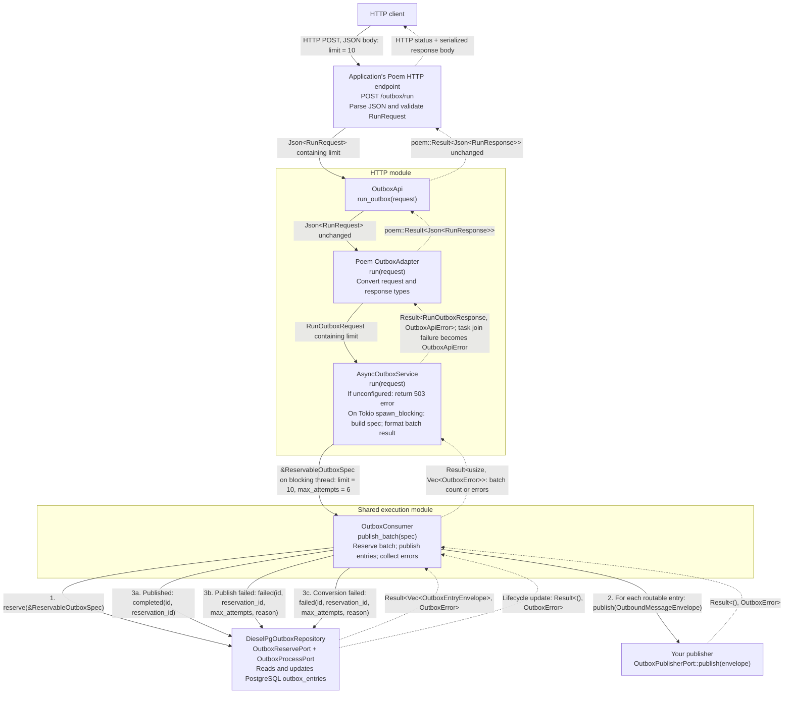

# mulac-outbox

## Module organization

- `src/execution/`: synchronous consumer and reservation specification. HTTP
  triggers and applications both call it.
- `src/http/`: shared HTTP contracts and the blocking-task bridge (`execution.rs`),
  plus Poem and Axum adapters.
- `src/application/`: envelopes, errors, storage and publisher ports, `OutboxRecorder`,
  conversions, and reservation recovery.
- `src/domain/` and `src/infra_diesel/`: lifecycle policy and database implementation.
- `src/amqp_publisher.rs` and `src/confirmed_amqp_publisher.rs`: optional AMQP
  publishers (feature `amqp`).

Import through `mulac_outbox::prelude`. Internal modules are private.

## Item failure isolation

Reservation is one transaction: malformed rows become `Failed`, and healthy
rows are returned without discarding the batch. Each consumer item contains
recoverable panics and attempts `Failed` on processing or completion errors,
then continues. Exhausted entries also stay `Failed`; the attempt cap still
prevents further automatic retries. No automatic path selects `Dead`.

Finalization still requires a working database/repository. Process termination,
abort-mode panics, and hung work require application-owned recovery; sweepers
must still be scheduled. See [the lifecycle and recovery contract](../../docs/item-failure-isolation.md)
for counts, diagnostics, retry timing, limitations, and PostgreSQL test commands.

## Dependency tree

Recording an entry and publishing it are separate steps. The recorder and consumer
must use the same outbox store; they can share one repository through `Arc`. To
make business writes and outbox events commit together, record on the business
transaction's own connection with `record_batch_on_connection` instead (see
[Recording](#recording)).

```text
Record
OutboxRecorder::new(store)
└── Arc<dyn OutboxStorePort>
    └── DieselPgOutboxRepository (the supported recording store; a test double in tests)
        └── DbPool → PostgreSQL outbox_entries table

Publish
OutboxConsumer::new(repository, publisher)
├── Arc<R: OutboxReservePort + OutboxProcessPort>
│   └── Same outbox repository/store as the recorder
└── Arc<dyn OutboxPublisherPort>
    └── AmqpPublisher, ConfirmedAmqpPublisher, or an application-supplied publisher

Reservation recovery (schedule separately)
ReservationSweeper::new(sweep)
└── Arc<dyn OutboxSweepPort>
    └── Same outbox repository/store
```

### Runtime inputs and responsibilities

1. Call `recorder.record_batch(&envelopes)` (or `record` for one event). The recorder
   validates the whole batch, then stores it atomically. Success means every event
   was recorded, not published. Failures are `RecordingError`s; see [Recording](#recording).
2. Call `consumer.publish_batch(&ReservableOutboxSpec::new(limit))` from an
   application-owned worker or explicit batch trigger. It blocks on storage and the
   publisher. Don't call it from async code, because publishers such as an AMQP
   bridge may block on the application runtime.
3. Call `sweeper.sweep(&StaleReservationSpec::new(timeout))` to recover expired
   reservations. Keep the sweeper and consumer `max_attempts` settings aligned.

`DieselPgOutboxRepository` implements all four storage ports and requires the
`diesel` feature, a database pool, and the outbox schema. It is the only supported
production **recording** store; applications may still implement the reservation,
processing, sweep and publisher ports themselves. HTTP and Tokio features are not
required for this flow.

Publishing and marking the entry completed are separate calls, not one atomic
transaction, so delivery is at least once.

## Poem: HTTP request through the structs and back

This diagram follows one request. The application mounts `OutboxApi` under `/outbox`
in this example. Solid arrows are calls and dotted arrows are returns. Calls below
the consumer repeat for each reserved entry.



### What changes at each boundary

| Struct               | Receives                | Passes onward                                                                  | Returns to its caller                                                                              |
| -------------------- | ----------------------- | ------------------------------------------------------------------------------ | -------------------------------------------------------------------------------------------------- |
| `OutboxApi`          | `Json<RunRequest>`      | Same request to adapter                                                        | `poem::Result<Json<RunResponse>>`                                                                  |
| Poem `OutboxAdapter` | `Json<RunRequest>`      | Validated `RunOutboxRequest`                                                   | Converts validation error or service result to `Json<RunResponse>` or `poem::Error`                |
| `AsyncOutboxService` | `RunOutboxRequest`      | `ReservableOutboxSpec { limit, max_attempts: 6 }` to consumer on blocking pool | Converts consumer result to `RunOutboxResponse`, or returns a missing-publisher or task-join error |
| `OutboxConsumer`     | `&ReservableOutboxSpec` | Reserved entries to publisher; lifecycle updates to repository                 | `Ok(count)` or `Err(Vec<OutboxError>)`                                                             |

### What reaches the HTTP client

- **Batch succeeds:** HTTP 200 with, for example,
  `{ "processed": 3, "errors": [] }`. The count can be less than the limit.
- **Consumer returns errors:** HTTP 200 with
  `{ "processed": null, "errors": ["<error id>"] }`, one logged ID per failure. Other entries in that batch may
  already have been published; this is not a transaction rollback.
- **Invalid request:** Poem rejects invalid input before the endpoint method, and
  the adapter also validates `limit` (`1..=1000`) when building
  `RunOutboxRequest`. Both map to HTTP 400, including when no publisher is configured. A bad `limit` keeps
  its message, and a body that can't be parsed returns only a logged error ID.
- **No publisher configured:** HTTP 503 with `outbox publisher is not configured`.
  Storage is not touched. Use `OutboxAdapter::unconfigured()` while delivery is off.
- **Blocking task fails to join:** HTTP 500 whose body is a logged error ID.

### Finding an error by ID

Error IDs are logged through `tracing` with the fields `error_id`, `queue` and `error`,
so search your logs for the ID. The host must install a `tracing` subscriber. Failures log
at `error` and unparsable bodies at `warn`. `EnvFilter::from_default_env()` shows only
`error` when `RUST_LOG` is unset, so set `RUST_LOG=warn` to see the IDs for unparsable bodies.

This endpoint publishes entries already recorded in storage; it does not record new
ones. The application constructs and supplies the consumer and its publisher, or
uses `AsyncOutboxService::from_postgres(pool, publisher)`.


## Recording

Complete rules, with the reasoning behind them, are in
[the outbox specification](../../docs/outbox-spec.md#recording). In short:

**Entry points.** `OutboxRecorder::record_batch` (envelopes), `OutboxStorePort::record_batch`
(entries), and, with the `diesel` feature, `record_batch_on_connection(&mut conn, &envelopes)`
on the caller's own Diesel connection. `record` is a batch of one. A batch is
all-or-nothing, and an empty batch succeeds without touching the database.
Success means each event was newly inserted or already stored with matching
content; there is no per-event result. Only the Diesel repository is a supported
production recording store, and the unsealed `OutboxStorePort` exists for test doubles.

**Validation** happens before any database access and rejects: a repeated event
ID in a batch; an entry ID that differs from its metadata event ID; a payload that
is not exactly one RFC 8259 JSON object (duplicate decoded keys, lone surrogates,
more than 127 nested containers); NUL in a metadata string; a blank routing key;
a sequence outside 1 to `i64::MAX`. Numbers of any magnitude and `\u0000` escapes
are accepted, and accepted payloads are stored exactly as supplied.

**Replay.** The event ID is the row's identity. Replaying a stored ID succeeds only
if the payload (object keys compared decoded and unordered, **numbers by exact
written form**: `1` is not `1.0`), message ID, routing key, event type, content type
and sequence all match; correlation ID, causation ID and source may differ and the
stored values are kept. Timestamps and delivery state are ignored and never
changed. A conflict fails the whole batch and never overwrites. Protection lasts
only while the row is retained: after deletion the same ID inserts, and publishes,
again.

**Failures.** `RecordingError` says what failed and, through `outcome()`, whether
the attempt added no rows or is *uncertain*. A failed commit or failed rollback is
always uncertain. A database timeout is a rolled-back database failure. Crate text
never quotes payload content, and `Display` is bounded while sources and ID lists
stay available as data.

**Retrying.** Choose event IDs and the replay-compared content once, before the
first attempt, and keep them (and any unresolved outcome) across reinvocation,
redrive and restart. Never mint replacement IDs while an outcome is uncertain.
Recording never retries internally. After an uncertain attempt, a conflict or
exhausted retries means stop and escalate. A retry with the same IDs can publish
them again.

**In a caller's transaction**, `record_batch_on_connection` needs an open
transaction (however it was opened, including raw `BEGIN`) and returns
`NoOpenTransaction` otherwise, writing nothing. It never begins or commits the
outer transaction; it uses a savepoint. Nothing is durable until the caller
commits. Propagate validation errors and conflicts by default; for any other
failure abandon the whole transaction and retry all of it. The caller's own
commit failure is not a recording error. Recording through the pooled recorder
while a business transaction is open on another connection commits independently:
a business rollback does not remove those rows or stop their publication.

**Waits and timeouts.** Recording can wait without limit on an uncommitted write of
the same event and holds its connection while it waits. Timeouts, and whether
recording shares a pool with consumers, are the caller's choice; the specification
shows how to set a database-side timeout and how to find the blocking session. A
caller that stops waiting without a result must treat the attempt as uncertain.

**Batch size.** There is no enforced maximum. A batch is one transaction on one
connection, its rows are invisible until it commits, and client memory is about
three times the payload size. About **1,000 to 5,000 events** per batch is a good
starting point; see
[the measurements](../../docs/outbox-bulk-recording-measurements.md).

**Deadlocks.** Batches that hold no other locks cannot deadlock at `READ COMMITTED`
([reasoning](../../docs/outbox-recording-deadlock-reasoning.md)); a transaction
that already holds locks can, and is retried whole.

**Event subscribers** that record must expect permanent conflicts. Under TwoPhased
eventing a conflict fails the event and retries it with the same ID: earlier
subscribers re-run and later ones never run. Under Direct eventing the error
returns to the caller and each command execution assigns new event IDs, so
re-dispatching after an uncertain outcome can publish a duplicate.

**Recovering from a permanent conflict.** The crate has no redrive or repair API.
The specification lists the options (resubmit the original content, drop the
event, use a new event ID, or leave the source event `Failed` and escalate) and
what each gives up.

The handler example, with a bounded retry loop and an application-owned error
type, is `examples/record_with_retry.rs`; CI compiles and runs it.
